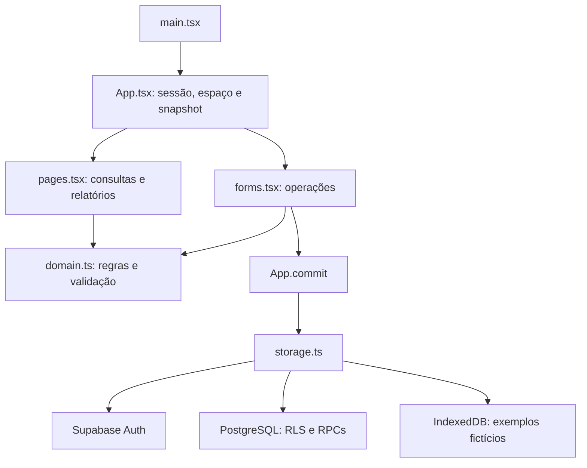

# Arquitetura e mapa dos arquivos

[Índice](README.md)

## Camadas

O Compasso é uma aplicação de página única em React e TypeScript. O Vite fornece desenvolvimento e empacotamento. Não há servidor Node de aplicação nem API própria intermediária: o navegador usa Supabase Auth, consultas às tabelas autorizadas e RPCs PostgreSQL.

A seleção de página e os diálogos são estados de React em `App.tsx`; não existe biblioteca de rotas. O caminho `/instalacao` exibe SQL para download. `?atualizacao=2` seleciona a segunda migração; `?invite=UUID` inicia aceitação de convite após login. Recuperação de senha considera o fragmento da URL e eventos do Auth.

As regras locais ficam em `domain.ts`. Os formulários produzem um novo `State`, submetido ao `commit`. Só após a persistência bem-sucedida o snapshot da interface é substituído e o modal fechado. O banco valida novamente os dados e as transições: esconder botões na interface não é autorização.

## Inventário completo dos arquivos versionados

| Arquivo | Responsabilidade e relação |
|---|---|
| `src/main.tsx` | Monta `App` em `#root` com `React.StrictMode`; importa os estilos na ordem base, tema. |
| `src/App.tsx` | Coordena sessão, modo fictício, espaços, participantes, mês, páginas, modais, leitura, gravação e detecção de revisão remota. Contém autenticação, instalação, criação de espaço, detalhes e configurações. |
| `src/domain.ts` | Tipos, schemas Zod, cálculos, validação estrutural e operações financeiras. Veja [domínio](dominio.md). |
| `src/storage.ts` | Cliente Supabase, consultas e RPCs; IndexedDB fictício; download e backup. Veja [banco](banco.md). |
| `src/forms.tsx` | Formulários e conversão das entradas de texto para o modelo. Veja [interface](interface.md). |
| `src/pages.tsx` | Painel, lançamentos/contas, cartões, terceiros, cadastros, orçamento e relatórios. |
| `src/components.tsx` | Modal com foco, campos, estados vazios, indicadores, tabela de lançamentos e progresso. |
| `src/demo.ts` | `demoData()` gera exemplos relativos ao mês atual, com salário, despesas, terceiro, compras parceladas e orçamentos. Usa IDs novos e regras reais; não acessa dados de produção. |
| `src/domain.test.ts` | Cenários Vitest das regras financeiras. |
| `src/styles.css` | Layout base, tipografia, grids, tabelas, gráficos, estados, formulários e adaptações responsivas. Importa DM Sans e Manrope de Google Fonts. |
| `src/theme.css` | Sobrescreve a apresentação para o tema azul; terceiros em violeta, mantendo cores semânticas dos status. |
| `scripts/test-database.mjs` | Cria PostgreSQL isolado via PGlite, simula Auth e verifica SQL, RLS e transições. |
| `scripts/check-cloud.mjs` | Verifica bloqueio de consulta e criação anônimas no Supabase configurado. |
| `supabase/migrations/001_compasso.sql` | Instala tabelas, índices, RLS, validações e RPCs em transação. |
| `supabase/migrations/002_convites.sql` | Substitui funções de convites/participantes para proteger último administrador e invalidar convites ao revogar acesso. |
| `index.html` | Documento `pt-BR`, metadados, favicon, `#root` e entrada do Vite. |
| `public/favicon.svg` | Identidade visual da aba; copiado pelo Vite para a saída. |
| `package.json` | Nome, versão, dependências e comandos. |
| `package-lock.json` | Resolução exata das dependências; usar `npm ci` em instalação reproduzível. |
| `tsconfig.json` | TypeScript estrito, ES2022, DOM, resolução Bundler, JSX React e `noEmit`. Inclui `src` e configuração Vite. |
| `vite.config.ts` | Plugin React; porta 5173 estrita; chunks separados para Recharts e Supabase. |
| `vitest.config.ts` | Descobre `src/**/*.test.ts`, com pool `forks`. |
| `.github/workflows/validacao.yml` | CI em PRs e pushes para `main`; Node 22, `npm ci`, testes financeiros, banco e build; limite de 10 minutos e permissão de leitura do código. |
| `.env.example` | Apenas exemplos de URL e chave pública Supabase. |
| `.gitignore` | Ignora dependências, build, ambientes privados, artefatos de teste, backups e capturas conhecidas. |
| `AGENTS.md` | Regras de branches, validação, proteção de dados e manutenção documental. |
| `README.md` | Instalação, uso, regras resumidas e limites operacionais. |
| `VALIDACAO.md` | Evidência histórica da entrega anterior, com dados fictícios. |
| `docs/*.md` | Guia técnico e histórico de atualização. |

## Ambiente e dependências

Requisito registrado no projeto: Node.js 22.12 ou superior. Scripts `dev` e `preview` vinculam o servidor a `127.0.0.1`; `dev` usa a porta 5173 estrita. `build` executa `tsc -b` e depois `vite build`. A saída está em `dist/`, ignorada pelo Git.

Dependências declaradas: React/React DOM 19, Supabase JS 2, Recharts 3, Zod 4 e Lucide React. Ferramentas: TypeScript 5.9, Vite 7, Vitest 3 e PGlite 0.3. Os intervalos estão em `package.json`; as versões resolvidas estão no lockfile.

`storage.ts` lê `VITE_SUPABASE_URL` e `VITE_SUPABASE_PUBLISHABLE_KEY`, com alternativa legada `VITE_SUPABASE_ANON_KEY`. Sem URL/chave ou com o marcador `SUA-CHAVE`, o cliente fica `null`; a interface oferece exemplos e orienta configuração. Variáveis `VITE_*` entram no bundle do navegador: somente chave pública, nunca credencial administrativa. Reinicie o Vite após alterações de ambiente.

Para preparar outro Supabase, siga o [README](../README.md). Nenhum script do frontend aplica migrações automaticamente. Uma hospedagem futura precisa entregar `index.html` também para `/instalacao` e configurar as URLs do Auth. A publicação requer autorização explícita.

## Estado e limites arquiteturais

`Snapshot = { data: State; revision: number }` mantém um documento inteiro por espaço. `State.version` identifica o formato; `revision` identifica a gravação. Participantes e permissões são relacionais e não estão no backup financeiro.

A leitura e a gravação carregam o documento inteiro. A cada 30 segundos a aplicação consulta revisão e participantes; não usa Realtime nem mescla alterações automaticamente. Não existe cache offline dos dados reais. O limite SQL é 10.000.000 bytes do texto JSONB, e o upload de backup limita o arquivo a 10.000.000 bytes. Grandes volumes exigem evolução de armazenamento e consultas; o histórico cresce por snapshot.
